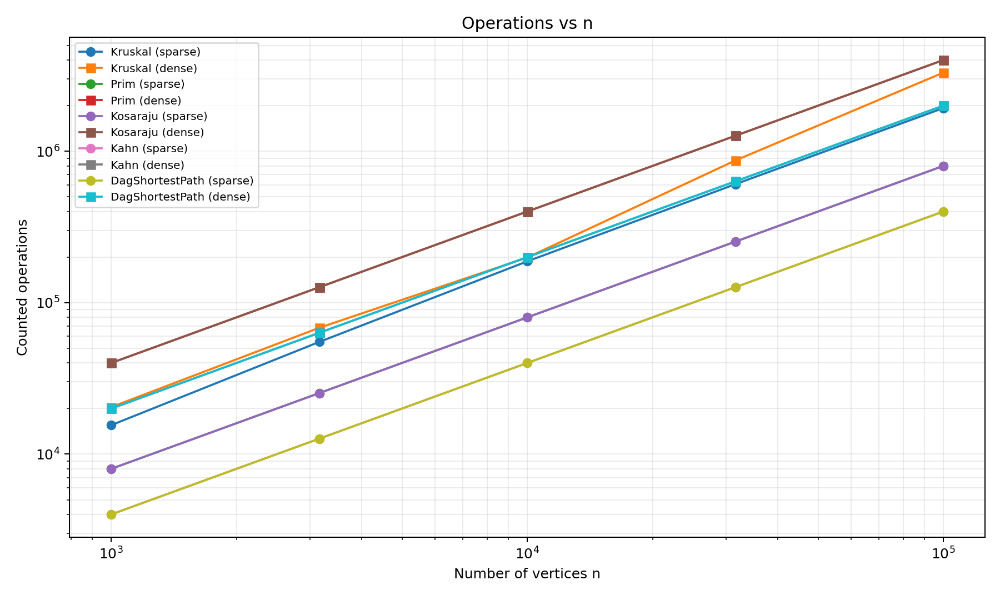
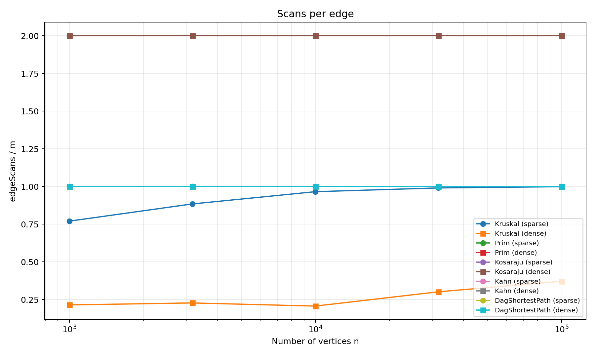
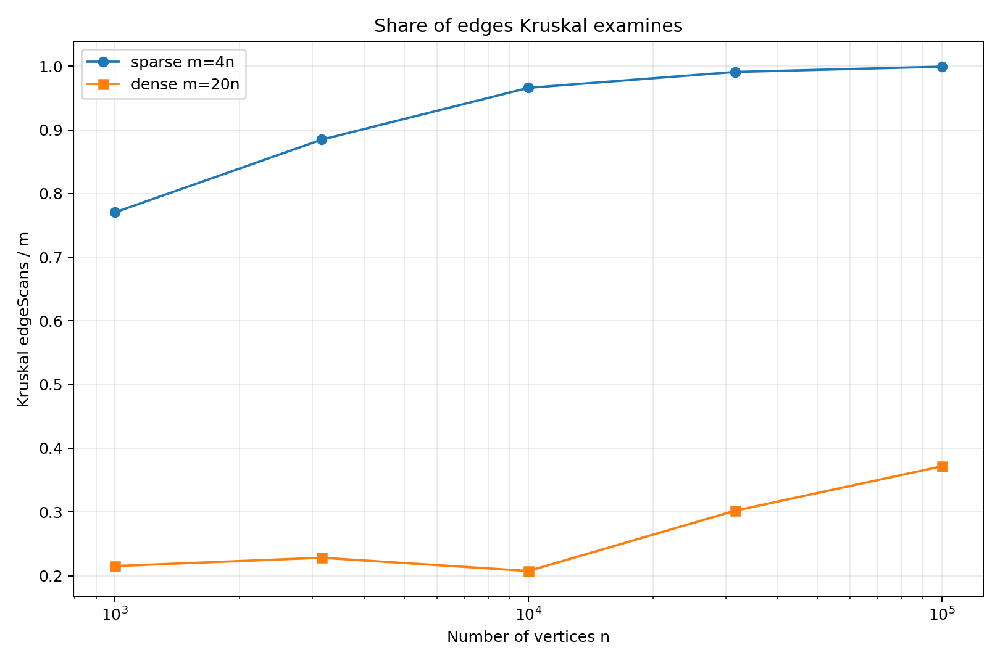

# DAA Assignment 3 — Graphs: DSU, MST, SCC and Shortest Paths

## 1. Overview

This project implements the six required graph components: Disjoint Set Union (DSU), Kruskal, Prim, Kosaraju, Kahn, and shortest paths in a directed acyclic graph (DAG). The graph core uses adjacency lists and supports both directed and undirected graphs with integer vertex weights. The implementation also includes text-file input, deterministic graph generation, operation counters, JUnit 5 tests, and a benchmark that checks the supplied reference values before writing its results.

The benchmark uses the five required vertex sizes, two densities, three graph kinds, and five timing repetitions. The timing reported in the CSV is the median of the five runs. Because wall-clock time changes with hardware, JVM warm-up, and background activity, the main performance evidence in this report is the deterministic operation counters.

## 2. Graph Core and DSU

The `Graph` class stores one adjacency list per vertex. For an undirected logical edge `(u,v,w)`, one edge is stored in each endpoint's adjacency list while the logical edge is stored once in `getEdges()`. This makes adjacency traversal O(V + E) and allows the same graph abstraction to be used by all algorithms. `GraphLoader` reads `n m directed|undirected` followed by `u v w` lines and rejects malformed input. The project includes connected, disconnected, and cyclic sample graphs in `data/`. Self-loops and parallel edges are retained rather than silently removed, so algorithms can handle them explicitly.

DSU initializes every vertex as its own set and maintains both a parent array and a size array. `find` performs path compression, while `union` attaches the smaller tree to the larger tree. The counters record find calls and successful union calls inside the operations, and `dsuOps` is their sum. With both heuristics, a sequence of operations has amortized O(alpha(V)) cost per operation, where alpha is the inverse Ackermann function and grows extraordinarily slowly.

## 3. Algorithm Complexity Table

| Algorithm | Time complexity | Extra space | Justification |
|---|---|---|---|
| DSU find/union | O(alpha(V)) amortized | O(V) | Path compression plus union by size bounds the amortized cost. |
| Kruskal | O(E log E) | O(V + E) | Sorting the edge list dominates; DSU operations are near-linear after sorting. |
| Prim | O((V + E) log V) with binary heap | O(V + E) | Each useful vertex/edge is handled through the priority queue and adjacency lists. |
| Kosaraju | O(V + E) | O(V + E) | Two DFS passes plus construction/traversal of the transpose are linear. |
| Kahn | O(V + E) | O(V + E) | Indegree construction, queue processing, and one outgoing-edge pass are linear. |
| DAG shortest paths | O(V + E) | O(V + E) | A topological order is followed by one relaxation pass over the edges. |

## 4. MST Correctness

Kruskal sorts all edges by nondecreasing weight and considers them in that order. When an edge joins two different DSU components, it crosses a cut between those components. Because every earlier edge was no lighter without already connecting the same components, the selected edge is a safe edge by the cut property. Adding only edges whose endpoints are in different components prevents cycles. The process continues until every component has a spanning tree, producing a minimum spanning forest for disconnected input. Prim starts with vertex 0 and repeatedly chooses the lightest edge leaving the current tree; for a disconnected graph it starts another component when the current component is exhausted. The same cut property makes each chosen minimum crossing edge safe, so both algorithms return the same minimum total weight even though their selected edge sets can differ.

The benchmark performs an automatic Kruskal-versus-Prim total-weight check on every generated graph. It also checks that a connected generated graph produces exactly `n - 1` selected edges. The unit tests additionally compare the two algorithms on 100 random connected graphs and test a disconnected graph explicitly.

## 5. SCC and Topological Ordering Correctness

Kosaraju performs a first DFS pass to record vertices by finishing time. The graph is then transposed, reversing every edge. Processing vertices in decreasing first-pass finishing order ensures that the second DFS cannot incorrectly cross from one SCC into another SCC that should remain separate. Each second-pass DFS tree therefore forms exactly one strongly connected component. The implementation uses an explicit stack of DFS frames rather than recursive method calls. This avoids JVM recursion-stack overflow on a path containing 100,000 vertices. The `maxDepth` metric records the deepest explicit stack reached, so stack safety is observable rather than merely assumed.

Kahn's algorithm first computes indegrees and inserts every zero-indegree vertex into a queue. Removing a vertex from the queue and deleting its outgoing dependencies preserves the invariant that every vertex emitted next has all predecessors already emitted. If all `n` vertices are emitted, the resulting order satisfies `pos[u] < pos[v]` for every edge `u -> v`. If fewer than `n` vertices are emitted, the remaining subgraph contains a cycle, so the algorithm reports a cycle instead of returning a false topological order. The benchmark independently validates the returned order on every generated DAG.

## 6. DAG Shortest Paths

The shortest-path implementation first obtains a topological order and then relaxes outgoing edges in that order. Before relaxation, every indegree-zero vertex is assigned distance zero, which is equivalent to adding a virtual super-source connected to all original source vertices by zero-weight edges. Consider a vertex when it appears in the topological order: every possible predecessor has already been processed. By induction, the predecessor distance is therefore final when the edge into the vertex is relaxed. Taking the minimum over all incoming edges consequently gives the correct shortest distance. Because a DAG has no directed cycle, negative edge weights cannot participate in a negative cycle, so negative weights are safe for this algorithm. Parent pointers are updated whenever a relaxation improves a distance, allowing a shortest path to be reconstructed for any reachable target.

The JUnit suite compares the DAG algorithm with Bellman-Ford on 100 small random DAGs containing negative weights. It also checks explicit path restoration and rejection of cyclic input.

## 7. Benchmark Methodology

The assignment requires five sizes in half-decade steps:

`1,000, 3,162, 10,000, 31,623, 100,000`

For each size, the benchmark uses sparse `m = 4n` and dense `m = 20n`. Each size/density pair has three graph kinds: an undirected graph for MST, a directed graph for Kosaraju, and a DAG for Kahn and DAG shortest paths. The generator follows the assignment procedure exactly: a `Random(42)` instance is used for each generated graph; the undirected graph first creates a shuffled random spanning tree; directed graphs use random non-self edges; and DAG edges are oriented according to a shuffled rank array. Every edge weight is `1 + rnd.nextInt(1000)`.

Five timing runs are performed for each algorithm and the median is written to the CSV. The benchmark also checks the supplied deterministic reference values and fails loudly if any result differs. The generated CSV contains 50 data rows and exactly these columns:

`algorithm,graph,n,m,time_ms,dsu_ops,edge_scans,comparisons,max_depth,result`

For `result`, the CSV stores MST weight for Kruskal/Prim, SCC count for Kosaraju, the number of vertices in the Kahn order, and the sum of all DAG shortest-path distances.

## 8. Reference-Value Check

The final benchmark reproduces all supplied reference values:

| n / m | MST weight | SCC count | DAG distance sum |
|---:|---:|---:|---:|
| 1,000 / 4,000 | 147,970 | 27 | 396,274 |
| 1,000 / 20,000 | 30,363 | 1 | 252,411 |
| 3,162 / 12,648 | 468,911 | 137 | 1,271,911 |
| 3,162 / 63,240 | 97,589 | 1 | 723,157 |
| 10,000 / 40,000 | 1,486,139 | 373 | 3,941,828 |
| 10,000 / 200,000 | 309,550 | 1 | 2,381,342 |
| 31,623 / 126,492 | 4,715,515 | 1,188 | 12,551,891 |
| 31,623 / 632,460 | 968,517 | 1 | 7,376,612 |
| 100,000 / 400,000 | 15,012,094 | 3,923 | 40,096,539 |
| 100,000 / 2,000,000 | 3,056,681 | 1 | 23,512,087 |

Kosaraju's `edgeScans / m` is exactly 2. Kahn's counted processing pass has `edgeScans / m = 1`, and DAG relaxation also has `edgeScans / m = 1` for every generated graph. Prim scans both adjacency copies of each undirected edge, so its ratio is 2. These flat ratios are the expected empirical signature of linear graph traversal.

## 9. Counters vs Complexity Formulas

The deterministic counter results support the theoretical formulas. For Prim, Kosaraju, Kahn, and DAG shortest paths, the relevant edge-scan ratios remain exactly constant as `n` grows: 2, 2, 1, and 1 respectively. This is the strongest direct evidence that their counted traversal work grows linearly with the input size. Kruskal's `edgeScans / m` approaches 1 on sparse graphs because more of the sorted edge list must be examined before the spanning tree is complete; on dense graphs the ratio is smaller because enough useful low-weight edges are encountered earlier. Kruskal's `dsuOps / m` remains bounded and of constant order across the tested sizes, consistent with the near-constant amortized DSU operation cost. Sorting is not represented by `edgeScans`, so Kruskal's theoretical O(E log E) behavior is expected to be slightly steeper than the purely linear traversals.

A log-log least-squares fit of `edgeScans` against `n` gives approximately:

- Kruskal, sparse: slope **1.046**
- Kruskal, dense: slope **1.104**
- Prim: slope **1.000** for both densities
- Kosaraju: slope **1.000** for both densities
- Kahn: slope **1.000** for both densities
- DAG shortest paths: slope **1.000** for both densities

The traversal slopes are therefore effectively 1.00, while Kruskal is slightly steeper because its work also contains the sorting component represented by O(E log E).

## 10. Required Plots

### Operations vs n



### Scans per edge



### Share of edges Kruskal examines



The first plot compares the main deterministic operation count for each algorithm and density. The second shows the flat traversal ratios directly. The third explains the MST behavior: Kruskal examines almost all sparse edges at large `n`, while it can stop after a smaller fraction of dense edges because many candidate edges are available before the forest is complete.

## 11. Which Algorithm When?

| Situation | Recommended algorithm | Why |
|---|---|---|
| Sparse weighted undirected graph, edge list | Kruskal | Sorting an edge list is natural and DSU makes cycle checks efficient. |
| Dense weighted undirected graph, adjacency list | Prim | It grows directly through adjacency lists and a priority queue without explicitly sorting the full edge list. |
| Directed graph where SCCs are required | Kosaraju | Two linear DFS passes find all strongly connected components. |
| DAG where a dependency order is required | Kahn | Indegrees and a queue produce a topological order and expose cycles. |
| DAG with shortest-path queries | DAG shortest paths | One topological relaxation pass gives O(V + E) shortest paths and supports negative weights. |
| Graph may contain cycles but only ordering is needed | Kahn | It detects a cycle instead of returning an invalid ordering. |
| Connectivity merging / cycle checks | DSU | Union by size and path compression make repeated connectivity operations extremely cheap. |

The graph representation also matters. Kruskal is especially convenient when the input is naturally an edge list, while Prim, Kosaraju, Kahn, and DAG relaxation benefit from adjacency-list traversal.

## 12. Time Discussion

The measured times are useful for demonstrating that the implementations run at the expected scale, but they are not the primary grading evidence because they depend on the CPU, JVM version, JIT warm-up, memory pressure, and other processes running on the machine. The two smallest graph sizes are particularly noisy, which is expected from the assignment specification. The benchmark therefore reports the median of five runs while the conclusions above rely mainly on deterministic counters and reference values. The important observation is that the traversal counters have stable linear ratios across all five sizes, while Kruskal's edge examination and sorting behavior is more sensitive to density.

## 13. Testing and Reproducibility

The JUnit 5 suite covers the graph core, graph loading, DSU behavior, 100 random connected MST graphs, SCC correctness against brute force, topological ordering and cycle detection, DAG shortest paths against Bellman-Ford with negative weights, and stack safety on a 100,000-vertex path. The three small files in `data/` cover connected, disconnected, and cyclic cases.

Run the full tests with:

```bash
mvn clean test
```

Run the benchmark with:

```bash
mvn -q -Dexec.mainClass=daa.benchmark.BenchmarkRunner exec:java
```

The same benchmark command recreates the deterministic reference values and rewrites `results/results.csv` and its compatibility copy `results/benchmark.csv`.

## 14. Conclusion

The implementation satisfies the main algorithmic goals of the assignment: it uses an adjacency-list graph, DSU with both required heuristics, two MST algorithms that agree on total weight, iterative SCC traversal, cycle-aware topological sorting, and linear-time DAG shortest paths with negative-weight support and path restoration. The deterministic benchmark reproduces all ten supplied reference triples and produces the required 50-row CSV. The operation ratios and fitted slopes agree with the expected complexity classes. The tests provide cross-checks against independent reference methods rather than relying only on the algorithms checking themselves. The accompanying plots and algorithm-selection table connect the measured behavior to the theoretical analysis required for the defense.
